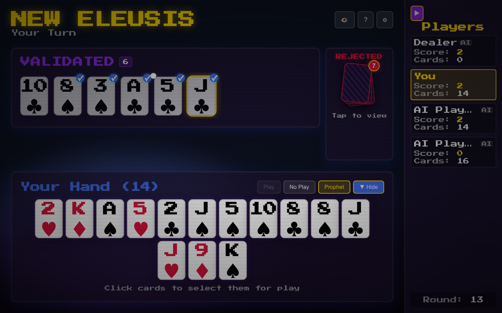
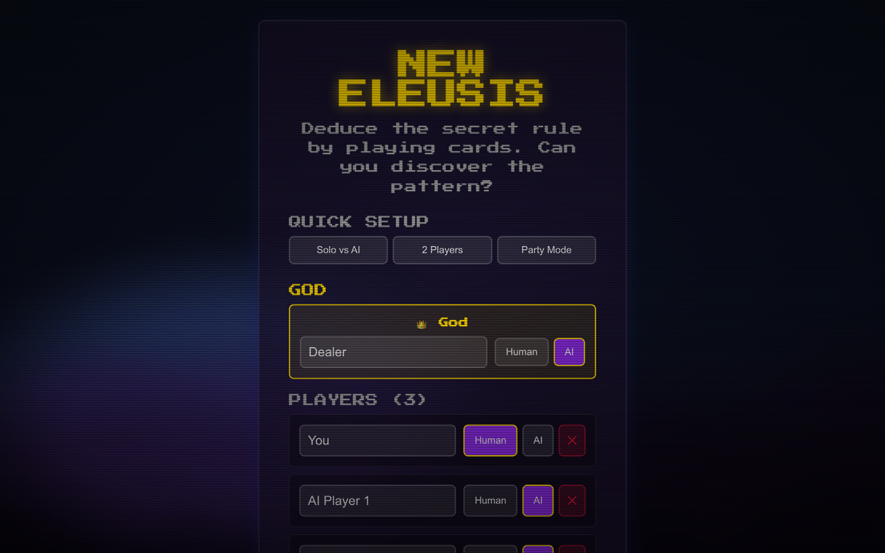
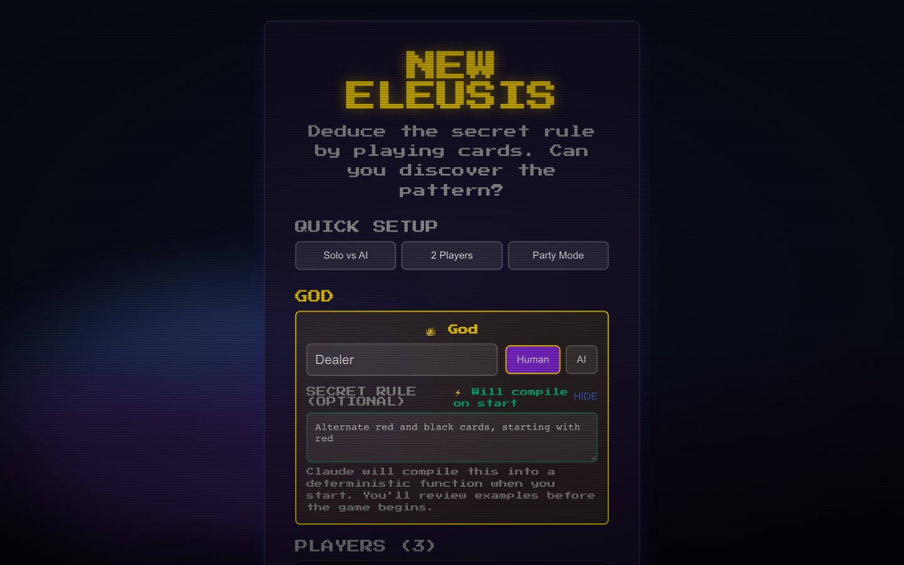
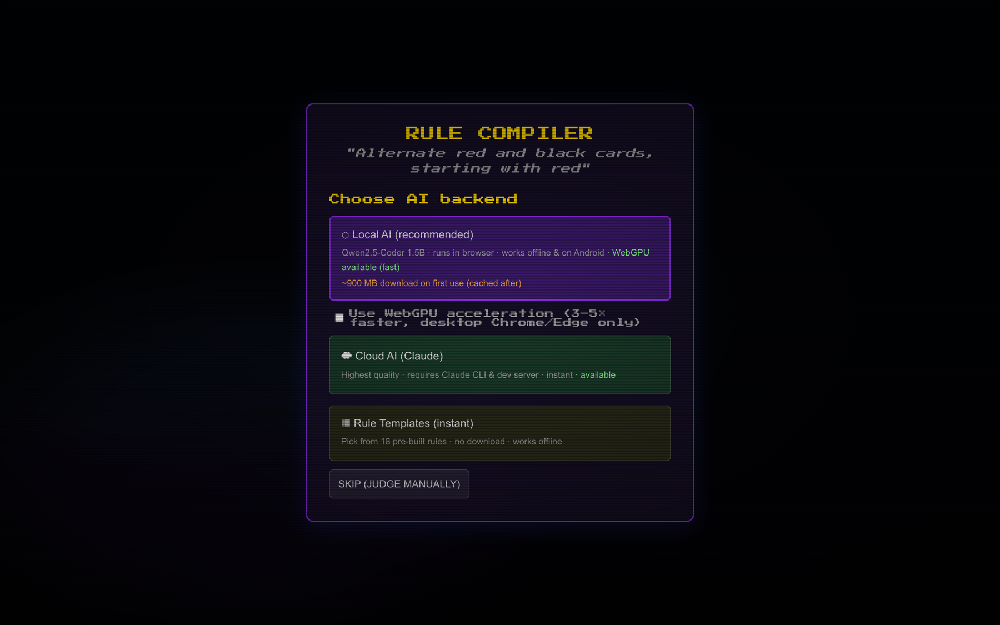
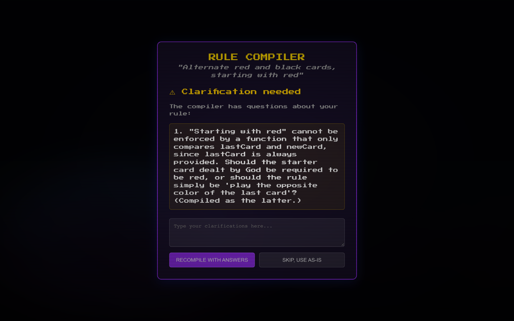
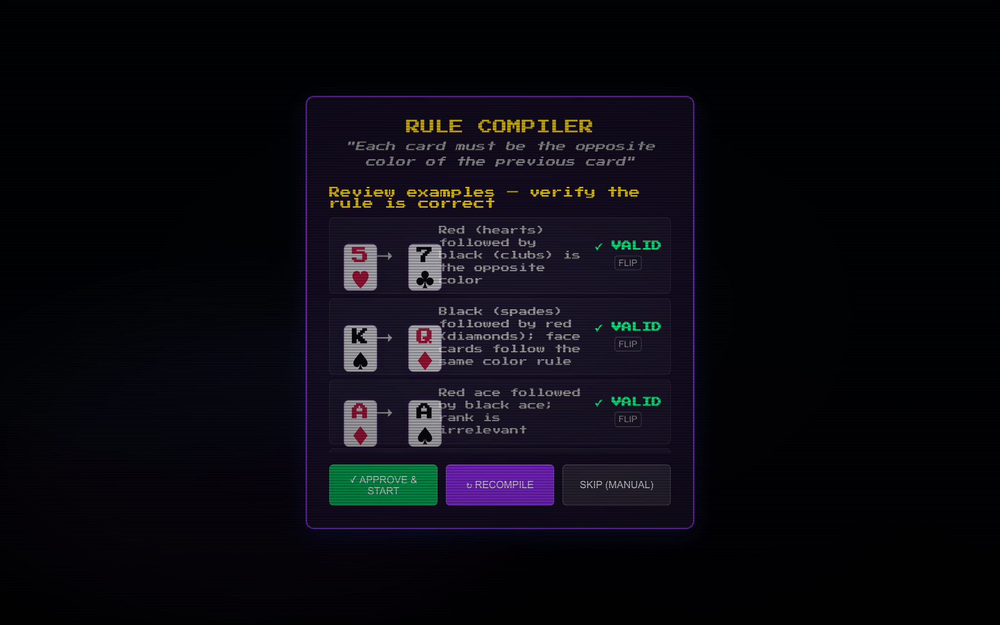

<h1 align="center">New Eleusis</h1>

<p align="center"><b>A digital take on the card game that turns the scientific method into play.</b></p>
<p align="center">One player invents a secret rule. Everyone else runs experiments, one card at a time, to work out what it is.</p>

<p align="center">
  
  
  
  
</p>

<p align="center">
  
</p>
<p align="center"><sub><i>Play a card, learn from the verdict, and narrow in on the hidden rule.</i></sub></p>

## Features

<table>
<tr>
<td width="50%" valign="top">

<sub><i>Round 13: the main line so far, and seven rejected plays waiting to be reviewed.</i></sub>
<h3>Play the experiment</h3>
Every card you play tests a hypothesis. Accepted plays build the validated main line, and rejected plays go to a rubbish bin you can open and study. When you think you've cracked it, declare yourself Prophet and start predicting for everyone else.
</td>
<td width="50%" valign="top">

<sub><i>Solo vs AI, 2 Players or Party Mode, then choose who plays God.</i></sub>
<h3>AI or human God</h3>
The dealer can be an AI that picks a secret rule from 41 built-in rules, or a human who invents their own. Mix human and AI players for solo play or pass-and-play hot-seat games.
</td>
</tr>
<tr>
<td width="50%" valign="top">

<sub><i>"Alternate red and black cards, starting with red."</i></sub>
<h3>Write a rule in plain English</h3>
A human God types the secret rule in ordinary words. It compiles into a deterministic judge function when the game starts, so every play is judged the same way.
</td>
<td width="50%" valign="top">

<sub><i>Local, cloud or template: pick how the rule gets compiled.</i></sub>
<h3>Local or cloud compiler</h3>
Compile with a local Qwen2.5-Coder model that runs in the browser and works offline (on Android too), with Claude through the dev server, or pick from ready-made rule templates with no download at all.
</td>
</tr>
<tr>
<td width="50%" valign="top">

<sub><i>The compiler flags a rule it can't enforce as written.</i></sub>
<h3>It asks when a rule is ambiguous</h3>
If a rule can't be expressed as written, the compiler says why and asks a question. Answer it and recompile, or accept its reading and carry on.
</td>
<td width="50%" valign="top">

<sub><i>Example plays to check before the game begins.</i></sub>
<h3>Verify before you play</h3>
The compiled rule comes back with worked examples. Flip any verdict that looks wrong and recompile, or approve and start, so the judge matches what you meant.
</td>
</tr>
</table>

Also included:

- **Prophet system**: declare yourself Prophet when you think you know the rule, then predict outcomes for other players.
- **Scoring and sudden death**: New Eleusis scoring, markers and sudden-death mechanics.
- **Android build**: wrapped with Capacitor.

## How it works

New Eleusis simulates scientific research. The dealer ("God" or "Nature") writes a secret rule that decides which cards may be played, based only on the cards already played correctly. The other players ("Scientists") play cards as experiments: legal plays extend the main line, illegal ones are set aside. Players race to form a theory, and the first with a good one can become Prophet. Others then try to overthrow the Prophet by finding an experiment whose result cannot be predicted.

The full rules are in [`NEW_ELEUSIS_RULES.md`](./NEW_ELEUSIS_RULES.md).

## Get started

```bash
npm install       # Install dependencies
npm run dev       # Start the development server
```

Other scripts:

```bash
npm run build     # Type-check and build for production
npm run lint      # Lint the codebase
npm run server    # Standalone rule compiler API (default port 3001)
npm run download-model  # Pre-download the local model
npm test          # Run the test suite
```

### Android (Capacitor)

```bash
npm run cap:sync  # Build and sync to Android
npm run cap:open  # Open in Android Studio
npm run cap:run   # Run on a connected device
```

## Rule compiler

The rule compiler turns natural language (for example, "alternate red and black cards") into a deterministic JavaScript judge function. Two backends are available:

- **Cloud** (dev only): routes through a Vite dev server plugin to the Claude CLI for high-quality compilation with examples.
- **Local** (everywhere): runs a quantized Qwen2.5-Coder 1.5B model in the browser with Transformers.js over WASM (about a 900 MB first-time download, cached, and cancellable from the UI).

Compiled functions are sandboxed with forbidden-pattern detection and stress-tested before use.

## Architecture

```
src/
├── engine/           # Pure TypeScript game logic (no UI dependencies)
│   ├── ai/           # AI dealer (rule bank), AI player, hypothesis engine
│   ├── types.ts      # Core type definitions
│   ├── reducer.ts    # Pure reducer for all state transitions
│   ├── validation.ts # Rule validation
│   ├── scoring.ts    # Score calculation
│   └── deck.ts       # Card utilities
├── store/            # Zustand state management (wraps the reducer)
├── components/       # React UI (retro arcade aesthetic)
├── utils/            # Shared card helpers
├── services/         # Rule compiler client service
└── audio/            # Sound effects
server/               # Rule compiler API (Vite dev plugin + standalone server)
scripts/              # Model download script
tests/                # Vitest suite, including a game-simulation harness
```

## Testing

```bash
npm test              # Unit + integration tests (873 tests across 39 files)
npm run test:rules    # Rule bank cross-validation (requires dev server + Claude CLI)
```

## License

[GNU Affero General Public License v3.0](LICENSE) (AGPL-3.0-only). You may use, change and share New Eleusis, but if you distribute it or run a changed version as a network service, you must offer its users the complete source under the same license.
